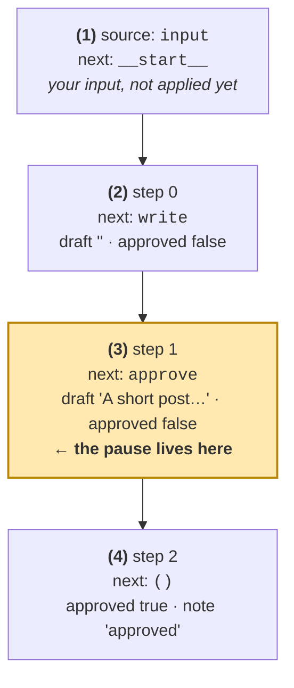

# Human-in-the-loop — the whole idea on one page

One graph. One question. One answer. Everything else in this session is a variation on what happens between the
two `invoke` calls below.

---

## 1. What a pause looks like

```text
invoke(input, config)
   │
   ├─ __start__ ─► write ─► approve ─╮
   │                                 │
   │                      interrupt() │  "Approve this draft?"
   │                                 ▼
   └────────── returns the state plus __interrupt__

        ┄┄┄ the process can exit here ┄┄┄
            nothing is lost: the thread is a row in the checkpointer

invoke(Command(resume=True), config)
   │
   └─ approve (from the top, see §4) ─► __end__
```

The return value of the first call is not an error, a timeout or an exception. It is an ordinary state dict with one
extra key, `__interrupt__`, holding the payload you passed to `interrupt()`. That payload is your question.

`Command(resume=...)` is how you answer it. The value you pass becomes the **return value of `interrupt()`** on the
node's second execution.

---

## 2. The four checkpoints of an approve

This is `example1_interrupt.py`, thread `post-1`, run to completion. Four checkpoints, in order.



Three things to read off it:

- **The pause is not a separate checkpoint.** `(3)` is simply "the next node is `approve`", written *before* the node
  ran. Interrupting does not add a checkpoint — it stops the node from ever finishing, so `next` keeps pointing at it.
- **`next` is where the run would continue.** `()` means finished. This one field is the difference between a paused
  graph and a dead one.
- **The question is stored too.** It is not in `values`; it sits on the pending task,
  `snapshot.tasks[0].interrupts[0].value`. That is how `example5_durable_approval.py` shows the question again in a
  brand-new process, read straight out of SQLite.

Everything Session 2 taught still applies: one checkpoint per super-step, a `parent_config` linking each to the last,
and `get_state_history()` returning them newest first. A human pause is a normal stop in that chain, just an
intentional one.

---

## 3. Two ways to pause, and when each is right

| | `interrupt()` in a node | `interrupt_before=` / `interrupt_after=` |
|---|---|---|
| Where it is declared | inside the node body | on `compile()` |
| Question shown to the caller | yes, your payload | **no** — nothing is returned |
| How you notice the pause | `"__interrupt__" in result` | `graph.get_state(config).next` |
| How you resume | `invoke(Command(resume=value), config)` | `invoke(None, config)` |
| Can the human say no? | **yes** — the value comes back | no; "no" means never resuming |
| Changes the node's code | yes | no |
| Re-runs the node on resume | yes, from the top | no, the node had not started |

The short version:

```text
human must DECIDE something  ->  interrupt()          (examples 1, 2, 4)
human only needs to LOOK     ->  interrupt_before=    (example 3)
```

A static breakpoint is a debugger pause. It is excellent for "stop here so I can inspect the state" and useless for
"stop here so someone can refuse the payment", because there is no channel to carry the refusal. Example 3 makes that
limitation concrete: the abandoned order sits at `next=('charge_card',)` forever, and no dashboard can tell it apart
from an approval nobody has got to yet.

---

## 4. Why the node body runs twice

`interrupt()` does not suspend a function in the middle and resume it later. There is no continuation to save. On
resume the **whole node is called again**, and the `interrupt()` inside it returns the stored answer instead of
pausing.

```text
first execution                       on resume
───────────────                       ─────────
approve(state) {                      approve(state) {
    send_email()    ◄── happens            send_email()    ◄── happens AGAIN
    answer = interrupt(...)  ◄── pauses   answer = interrupt(...)  ◄── returns True
    ...                                   ...
}                                     }
```

Anything with a side effect — an email, a webhook, a `INSERT`, a charge — placed above `interrupt()` runs twice.
`example1_interrupt.py` proves it with a `TRACE` list; the test suite asserts it.

### The fix is a node boundary, not a flag

```text
        ✗ one node, ask + act                 ✓ two nodes, ask then act

        ┌──────────────────┐                  ┌──────────┐      ┌──────────┐
        │  approve         │                  │  guard   │─────►│  tools   │
        │  send_email()    │                  │  asks    │      │  acts    │
        │  interrupt()     │                  │  only    │      │  once    │
        │  delete_rows()   │                  └──────────┘      └──────────┘
        └──────────────────┘
         runs twice                           guard re-running is harmless:
                                              asking twice changes nothing
```

`example4_tool_approval.py` is that split. The `guard` node only interrupts and returns a boolean; `tools` only acts,
and only after a `True` arrived. The test `test_approved_tool_runs_exactly_once` pins it down.

---

## 5. Cheat sheet

| You want to… | Call | You get back |
|---|---|---|
| pause and ask | `interrupt(payload)` inside a node | — |
| see the question | `result["__interrupt__"][0].value` | your payload |
| see where it stopped | `graph.get_state(config).next` | `('approve',)` |
| answer it | `invoke(Command(resume=value), config)` | the finished state |
| pause without asking | `compile(interrupt_before=[...])` | no `__interrupt__` |
| continue a static pause | `invoke(None, config)` | the finished state |
| answer in a later process | same call, same thread, new checkpointer connection | the finished state |

Two things that look like they should work but silently do not:

- **`interrupt()` with no checkpointer.** It does not raise. `invoke` returns a state with `__interrupt__` and the run
  is simply dead — there is no thread to resume. Always pass a checkpointer.
- **`Command(resume=...)` on a thread that is not paused.** It does not raise either. It returns the existing state and
  your value is dropped.
